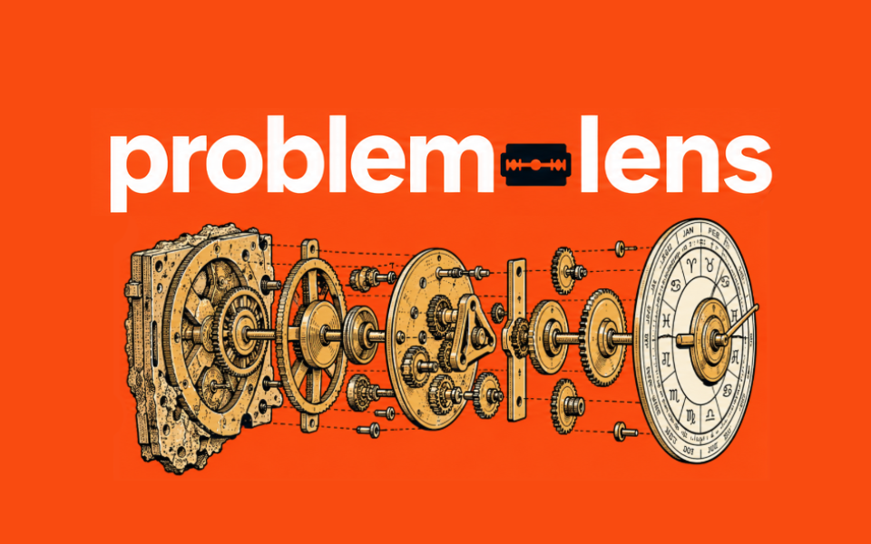
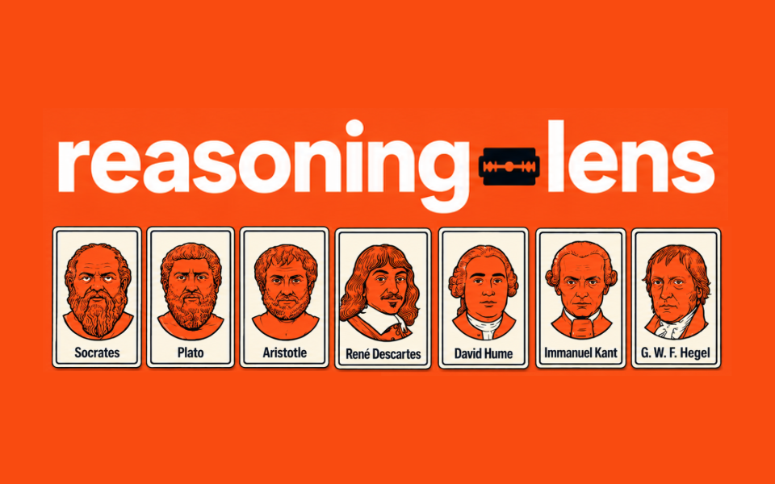
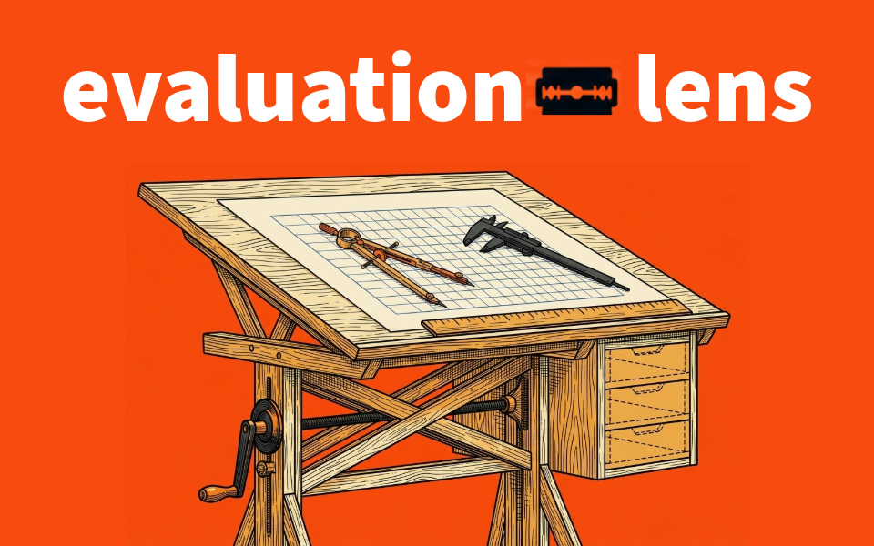
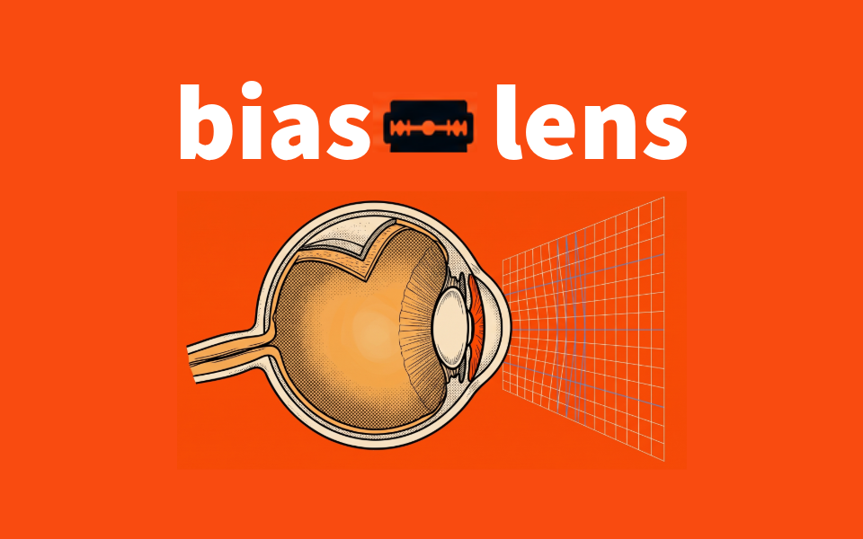
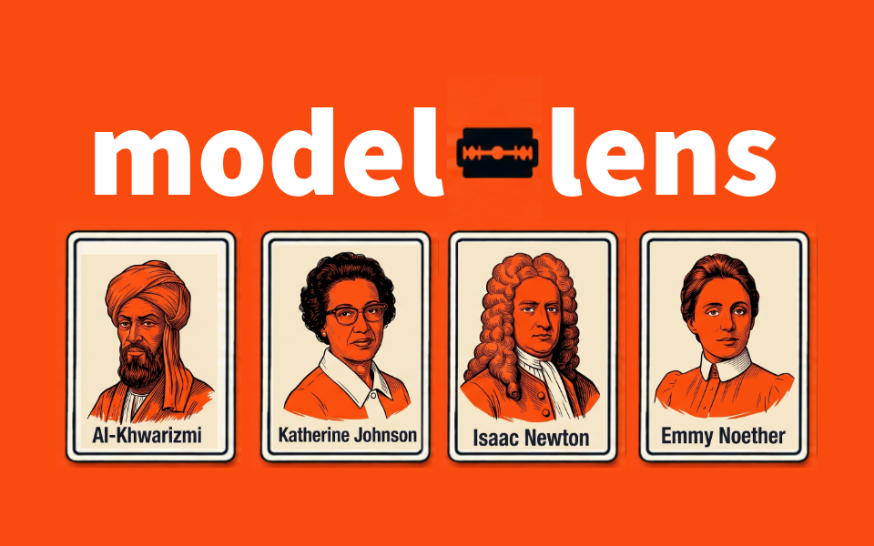
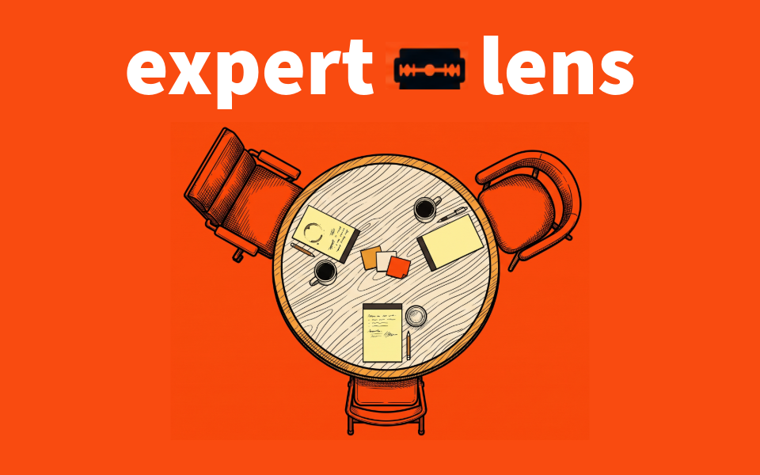
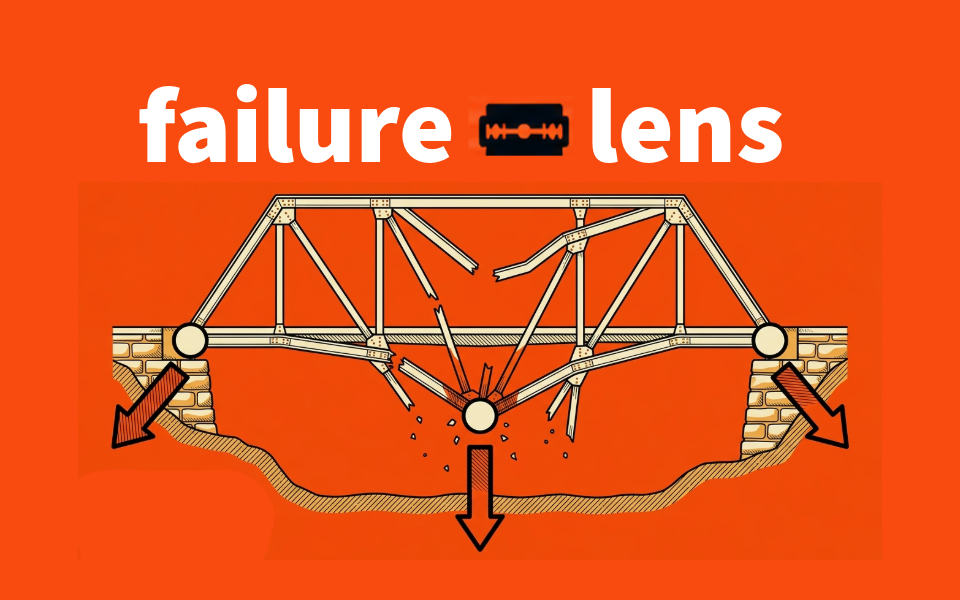
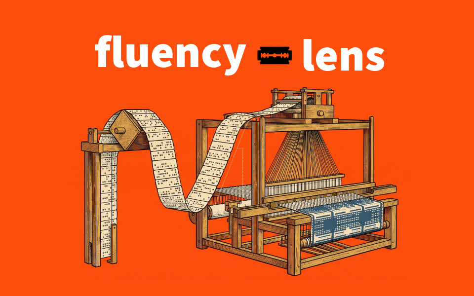
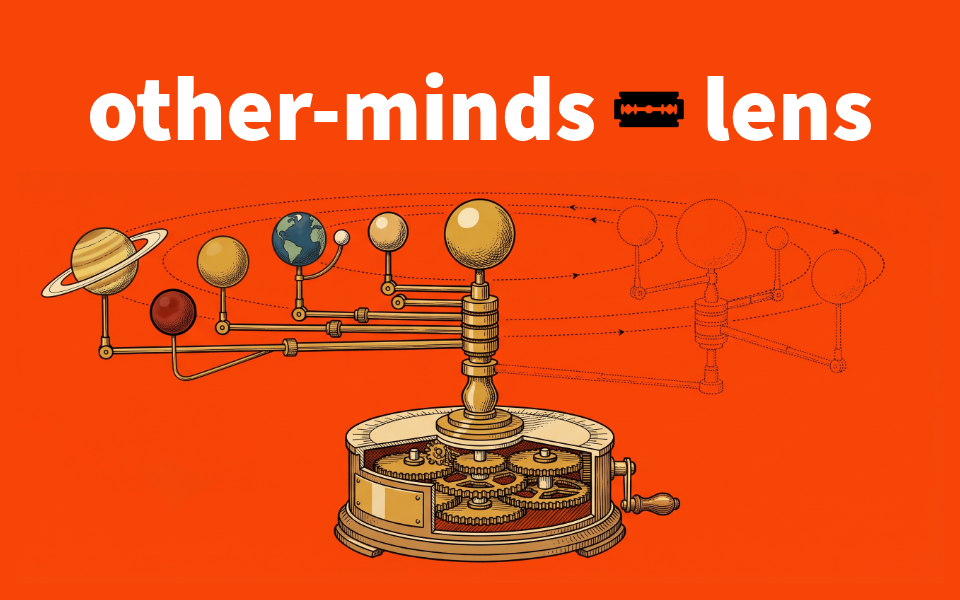

  

# Ockham

**Old tools for modern thinking.**

You know it as Occam's razor. Ockham is the original spelling: the village in Surrey where William of Ockham was born. The razor cuts to what matters. These Claude Skills don't solve problems for you. They help you revise your own thinking and writing.

I'm Dave Hallmon, an AI enablement consultant and adjunct instructor in AI/ML and deep learning. I build these for my classes, my workshops, and my own work.

---

## Organon · thinking tools

*Organon* is Greek for "tool." It's also the name of Aristotle's books on logic. These Skills examine an idea from several angles before you commit to it.

| Skill | What it does | Status |
|---|---|---|
| [problem-lens](https://github.com/davehallmon/problem-lens) | Looks at a problem through several lenses | Released |
| [reasoning-lens](https://github.com/davehallmon/reasoning-lens) | Runs an idea past seven philosophers' ways of reasoning and shows where they disagree | Experimental, evaluation pending |
| evaluation-lens | Scores a draft against a rubric before revising | Coming soon |
| bias-lens | Surfaces unstated assumptions and confirmation bias | Coming soon |
| model-lens | Details coming soon | Coming soon |
| expert-lens | Puts an idea before a panel of experts and keeps their dissent visible | Coming soon |
| failure-lens | Assumes the plan failed and traces the causes back to today's decisions | Coming soon |
| fluency-lens | Audits an AI-assisted workflow against six Ds | Coming soon |
| other-minds-lens | Sees the idea through someone else's incentives and constraints | Coming soon |

<table>
<tr>
<td width="33%" valign="top"></td>
<td width="33%" valign="top"></td>
<td width="33%" valign="top"></td>
</tr>
<tr>
<td width="33%" valign="top"></td>
<td width="33%" valign="top"></td>
<td width="33%" valign="top"></td>
</tr>
<tr>
<td width="33%" valign="top"></td>
<td width="33%" valign="top"></td>
<td width="33%" valign="top"></td>
</tr>
</table>

fluency-lens builds on the four Ds of the [AI Fluency Framework](https://aifluencyframework.org/) by Rick Dakan and Joseph Feller, developed with Anthropic: Delegation, Description, Discernment, and Diligence. It adds two: Data Decisions and Development.

---

## Novacula · writing tools *(coming soon)*

*Novacula* is the scribe's scraping knife, the tool that made revision possible. These Skills revise writing against named standards: ASD-STE100 Simplified Technical English, Orwell's rules, the Minto Pyramid Principle, Flesch readability scores, and your own voice.

---

*All Skills are free and open source. Released versions note their evaluation status.*

## What these Skills can't judge

A lens focuses, and it also narrows. Each published Skill says what its lens cannot see. None of them can judge taste: whether a design, a sentence, or an argument feels right. They can show what a draft does. What it should be stays with you.

## Building in public

A small snapshot of the work behind the ideas.

<picture>
  
</picture>

---

## Let's discover our unknown unknowns together.

Ideas, criticism, experiments, and contributions are welcome.

